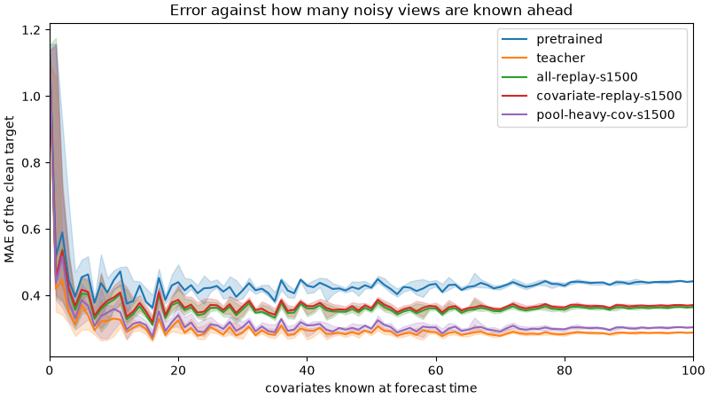

# Replaying real series with their covariates

Whether the fev cost left by the [teacher replay](distill-replay.md) can be removed by replaying the one shape the replay lacks: real series with covariates. Every replay so far was history only, and the remaining fev cost sits on the covariate subset. Univariate [real series](real-replay.md) did not reach it.

## The task

`realcov` draws one of eight multivariate datasets from the leak-checked GIFT-Eval pretraining split: the Beijing, Hangzhou and Shanghai metro flows, PEMS04, PEMS08, Beijing and China air quality, and subseasonal weather. One variate is the target, and up to four others of the same series are its covariates. Each covariate is known over the horizon with its true future values, or, with probability 0.5, stops at the origin as a past covariate. The label is the frozen pretrained 5M model's forecast given the same covariates, so the task holds the pretrained use of real covariates in place. Every 20th series is held out. The eval scores those series with their covariates (`realcov/heldout`) and without (`realcov/heldout-none`).

This branch also weights the horizon draw for the real windows and drops the fully-observed-future check when the label is a teacher. The [real-replay](real-replay.md) runs predate that.

## Runs

Batch 16, peak lr 3e-5, seed 0 unless noted. Shares are a task's weight over the sum of the weights.

| run | mixture | steps | training run |
|---|---|---:|---|
| `wide-teacher-209m` | the wide replay, labelled by the 209M model | 6000 | [`3lb7gyoj`](https://forge.coreweave.com/wandb/tfiedlerdev/time-series-models/runs/3lb7gyoj) |
| `covariate-replay` | teacher replay plus `realcov` at 11% | 6000 | [`0at8ilic`](https://forge.coreweave.com/wandb/tfiedlerdev/time-series-models/runs/0at8ilic) |
| `covariate-replay-s1500` | the same | 1500 | [`uex4wnnv`](https://forge.coreweave.com/wandb/tfiedlerdev/time-series-models/runs/uex4wnnv) |
| `all-replay-s1500` | wide replay, `real` truth at 22%, `realcov` at 8% | 1500 | [`81tr5f90`](https://forge.coreweave.com/wandb/tfiedlerdev/time-series-models/runs/81tr5f90) |
| `all-replay-s1500-seed1` | the same, seed 1 | 1500 | [`42i5c2ng`](https://forge.coreweave.com/wandb/tfiedlerdev/time-series-models/runs/42i5c2ng) |
| `pool-heavy-cov-s1500` | covariate replay with pooling at 26%, weighted toward many views | 1500 | [`04kbycbq`](https://forge.coreweave.com/wandb/tfiedlerdev/time-series-models/runs/04kbycbq) |

The configs are `configs/wide-teacher-209m.yaml`, `covariate-replay.yaml`, `all-replay.yaml` and `pool-heavy-cov.yaml`. The 1500-step runs pass `--steps 1500`.

## Benchmarks

Changes are in the error against pretrained Timestral-5M, so a negative number is a lower error. TIME is all 98 tasks. fev is the 26-task covariate subset. The two reference rows are the teacher replay at 6000 steps, and the [short post-train](https://github.com/tfiedlerdev/time-series-models/pull/7) at 1500 steps with its two seeds.

| run | TIME MASE | TIME QL | TIME tasks >+1% | fev SQL | fev SQL median | fev MASE | fev tasks lower |
|---|---:|---:|---:|---:|---:|---:|---:|
| teacher replay, 6000 | +0.11% | +0.05% | 4 | +2.27% | +1.27% | +2.46% | 5 of 26 |
| teacher replay, 1500, seeds 0 / 1 | +0.06% / +0.21% | +0.05% / +0.13% | 4 / 8 | +0.83% / +1.10% | +0.13% / +0.08% | +1.01% / +1.28% | 11 / 12 |
| wide replay, 209M labels | +0.51% | +0.34% | 23 | +3.02% | +0.92% | +3.25% | 6 |
| covariate replay, 6000 | +0.05% | +0.03% | 1 | +0.68% | +0.10% | +0.83% | 10 |
| covariate replay, 1500 | +0.10% | +0.03% | 2 | +0.39% | −0.00% | +0.48% | 14 |
| all replays, 1500, seed 0 | +0.05% | +0.03% | 3 | +0.26% | +0.04% | +0.34% | 10 |
| all replays, 1500, seed 1 | +0.05% | +0.01% | 2 | +0.31% | +0.02% | +0.35% | 11 |
| pool-heavy covariate replay, 1500 | +0.05% | −0.00% | 0 | +0.56% | +0.08% | +0.66% | 9 |

The benchmark runs on W&B:

- TIME: [`z2c2a7id`](https://forge.coreweave.com/wandb/tfiedlerdev/time-series-models/runs/z2c2a7id), [`fswcjhvr`](https://forge.coreweave.com/wandb/tfiedlerdev/time-series-models/runs/fswcjhvr), [`m1v8nsy0`](https://forge.coreweave.com/wandb/tfiedlerdev/time-series-models/runs/m1v8nsy0), [`ksef8gn4`](https://forge.coreweave.com/wandb/tfiedlerdev/time-series-models/runs/ksef8gn4), [`wlohbhhk`](https://forge.coreweave.com/wandb/tfiedlerdev/time-series-models/runs/wlohbhhk), [`5ir9vcet`](https://forge.coreweave.com/wandb/tfiedlerdev/time-series-models/runs/5ir9vcet), in the order of the runs table.
- fev: [`shljkkhm`](https://forge.coreweave.com/wandb/tfiedlerdev/time-series-models/runs/shljkkhm), [`zlilo6t4`](https://forge.coreweave.com/wandb/tfiedlerdev/time-series-models/runs/zlilo6t4), [`ixgbmcyr`](https://forge.coreweave.com/wandb/tfiedlerdev/time-series-models/runs/ixgbmcyr), [`4qsuqltx`](https://forge.coreweave.com/wandb/tfiedlerdev/time-series-models/runs/4qsuqltx), [`awgo9xfo`](https://forge.coreweave.com/wandb/tfiedlerdev/time-series-models/runs/awgo9xfo), [`cfxxz4jn`](https://forge.coreweave.com/wandb/tfiedlerdev/time-series-models/runs/cfxxz4jn), in the same order.

## What the fine-tunes keep

The training eval, 32 series, the same draws for every model. W&B runs [`oh8ud8g3`](https://forge.coreweave.com/wandb/tfiedlerdev/time-series-models/runs/oh8ud8g3) (teacher replay), [`e7kivcbo`](https://forge.coreweave.com/wandb/tfiedlerdev/time-series-models/runs/e7kivcbo) (209M labels), [`ek85zo39`](https://forge.coreweave.com/wandb/tfiedlerdev/time-series-models/runs/ek85zo39) (covariate replay, 6000), [`th6jnw9g`](https://forge.coreweave.com/wandb/tfiedlerdev/time-series-models/runs/th6jnw9g) (covariate replay and all replays, 1500) and [`k7sm5n42`](https://forge.coreweave.com/wandb/tfiedlerdev/time-series-models/runs/k7sm5n42) (pool-heavy covariate replay). The pretrained column is the same in all of them.

| task | pretrained | teacher, 6000 | 209M labels | cov., 6000 | cov., 1500 | all, 1500 | pool-heavy cov., 1500 |
|---|---:|---:|---:|---:|---:|---:|---:|
| pool/64 | 0.380 | 0.266 | 0.260 | 0.279 | 0.317 | 0.330 | 0.272 |
| views/64 | 0.351 | 0.264 | 0.258 | 0.274 | 0.306 | 0.309 | 0.262 |
| categorical/random | 1.329 | 1.137 | 1.061 | 1.139 | 1.202 | 1.232 | 1.194 |
| exogenous/daily | 0.470 | 0.415 | 0.420 | 0.419 | 0.428 | 0.416 | 0.432 |
| generic/kernel | 0.219 | 0.223 | 0.175 | 0.221 | 0.233 | 0.216 | 0.216 |
| real/heldout | 0.502 | 0.507 | 0.478 | 0.505 | 0.503 | 0.502 | 0.504 |
| realcov/heldout | 0.341 | 0.318 | 0.308 | 0.331 | 0.333 | 0.333 | 0.323 |
| realcov/heldout-none | 0.370 | 0.375 | 0.421 | 0.378 | 0.371 | 0.366 | 0.368 |

The view curve, from `view_curve.py` as extended in [PR #10](https://github.com/tfiedlerdev/time-series-models/pull/10):

| known views | pretrained | teacher, 6000 | all, 1500 | cov., 1500 | pool-heavy cov., 1500 |
|---:|---:|---:|---:|---:|---:|
| 1 | 0.517 | 0.419 | 0.450 | 0.454 | 0.435 |
| 8 | 0.437 | 0.322 | 0.359 | 0.366 | 0.337 |
| 16 | 0.363 | 0.268 | 0.312 | 0.320 | 0.276 |
| 64 | 0.417 | 0.281 | 0.348 | 0.355 | 0.293 |
| 100 | 0.443 | 0.289 | 0.365 | 0.371 | 0.305 |

## What follows

Replaying real covariate series against the pretrained forecast removes most of the fev cost. At 6000 steps it takes fev SQL from +2.3% to +0.7% with an 11% share. At 1500 steps the median fev task is unchanged and 14 of 26 are below the pretrained error. Adding the univariate real share and the wide replay brings the mean to +0.3%, and a second seed lands within 0.05 points. TIME stays flat in every covariate-replay run, with at most 3 of 98 tasks more than 1% worse.

The 209M labels on the wide replay repeat the [teacher-size](teacher-size.md) result. They give the best held-out real and synthetic numbers in this table, and the worst benchmarks.

The short runs give up pooling, and the pooling share buys it back for a little fev. With pooling at 26%, the 1500-step covariate replay is at 0.272 on the 64-view pool task, level with the 6000-step teacher replay, and 0.293 on the view curve against 0.281. TIME is the flattest of any run: quantile loss −0.00%, MASE +0.05%, no task more than 1% worse. fev SQL is +0.56%, against +2.27% for the teacher replay it replaces.

`configs/pool-heavy-cov.yaml` at 1500 steps is the mixture to build on: the new capability at its 6000-step level, TIME held, and a quarter of the fev cost. Where fev matters more than pooling, `configs/all-replay.yaml` at 1500 steps is the lower-cost choice. The remaining fev cost in both comes from the covariate-shaped synthetic tasks. A larger `realcov` share, or more multivariate datasets, is the next thing to try against it.
