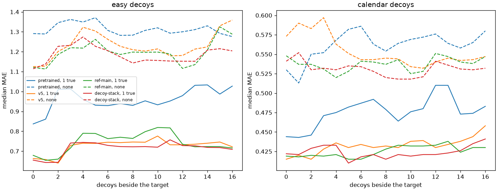

# A true reading beside a stack of partial matches

Whether a longer stack of partial-match decoys, placed beside the true exogenous reading during training, changes how much that reading is worth once the stack grows.

## Setup

The sweep is the one in [decoy-sweep.md](decoy-sweep.md): one target, one true covariate, a pool of 16 decoys, and every count from 0 through 16. The dashed lines drop the true covariate and keep the same decoys. This pass uses 32 series, seed 0. The earlier note used 8, and re-running those 8 reproduces its table.

`easy` decoys are a random walk, a trend, or a different season. `calendar` decoys share both cycles, the daily cycle with the weekly cycle flipped, or the slope, each plus its own walk.

Four models, scored on the same draws:

- Pretrained Timestral-5M.
- `v5`, artifact `timestral-5m-pool-mix:v5`, W&B run [`j4qk2igb`](https://forge.coreweave.com/wandb/tfiedlerdev/time-series-models/runs/j4qk2igb). This is the checkpoint behind decoy-sweep.md. Its decoys shared both cycles, and there were one or two of them.
- `ref-main`, artifact `timestral-5m-pool-mix:ref-main`, W&B run [`06cmyv72`](https://forge.coreweave.com/wandb/tfiedlerdev/time-series-models/runs/06cmyv72). A fresh 6000-step, batch-16 run of the checked-in mixture. That mixture draws the partial-match kinds and still stops at one or two decoys.
- `decoy-stack-p50`, artifact `timestral-5m-pool-mix:decoy-stack-p50`, W&B run [`toliyn8z`](https://forge.coreweave.com/wandb/tfiedlerdev/time-series-models/runs/toliyn8z). The same mixture, with half of the exogenous batches that keep a true reading drawing a stack of 0 to 16 partial matches, most of the mass above two.

The training eval of the reference and the stack run, on 32 shared series, is W&B run [`nnkqdib7`](https://forge.coreweave.com/wandb/tfiedlerdev/time-series-models/runs/nnkqdib7).

| decoys | pretrained, 1 true | v5, 1 true | ref-main, 1 true | stack, 1 true | pretrained, none | v5, none | ref-main, none | stack, none |
|---:|---:|---:|---:|---:|---:|---:|---:|---:|
| 0 | 0.444 | 0.415 | 0.419 | 0.422 | 0.530 | 0.573 | 0.548 | 0.541 |
| 8 | 0.479 | 0.432 | 0.428 | 0.415 | 0.554 | 0.545 | 0.537 | 0.520 |
| 16 | 0.483 | 0.458 | 0.430 | 0.441 | 0.580 | 0.547 | 0.547 | 0.532 |

Calendar decoys. The figure has every count.

On the same 32 calendar series, the gap is the error with the decoys only minus the error with the true row kept. A positive gap means the true row still helps.

| model | median gap at 8 | series where the row helps | median gap at 16 | series where the row helps |
|---|---:|---:|---:|---:|
| pretrained | +0.119 | 75% | +0.090 | 78% |
| v5 | +0.122 | 75% | +0.118 | 81% |
| ref-main | +0.129 | 84% | +0.102 | 84% |
| stack | +0.168 | 81% | +0.142 | 81% |

"Helps" means the true row lowers that series' error by more than 0.02. At 16 decoys the row is within 0.02 of the decoys-only forecast on 12% of series for the pretrained model, 6% for v5, and 3% for the reference and the stack run.

## What it shows

The blend in decoy-sweep.md is the median of its eight series. On 32 series the same checkpoint keeps the driver. v5 moves from 0.415 with no calendar decoys to 0.432 at eight and 0.458 at sixteen, and the decoys-only line stays near 0.55. The reference and the stack run sit with it, near 0.43 across the whole count.

The stack task leaves the true-row error where the reference has it. At sixteen decoys the stack run is at 0.441 and the reference at 0.430. The wider gap in the table comes from a slightly lower decoys-only error.

Easy decoys tell the same story. With the true row, all three fine-tunes stay near 0.7 through sixteen, and the pretrained model stays near 1.0. The dashed lines sit near 1.2.

On the shared training eval the stack run matches the reference. Pooling at 64 views is 0.258 against 0.253, and one exogenous reading is 0.413 against 0.409. Both stay below the pretrained model, 0.380 and 0.483.

TIME is W&B run [`gkzi6j7g`](https://forge.coreweave.com/wandb/tfiedlerdev/time-series-models/runs/gkzi6j7g), against the cached pretrained baseline. On the 60 tasks scored so far the mean relative change is -4.3% for the stack run and -4.0% for the reference, on the same tasks. The reference's finished TIME run, all 98 tasks, is -3.5%, run [`c1zb66vp`](https://forge.coreweave.com/wandb/tfiedlerdev/time-series-models/runs/c1zb66vp).

## What follows

A stack of partial matches was the task that would have punished a model for washing the driver out. On 32 series the driver is still worth about a tenth of MAE at sixteen decoys, for the old checkpoint and for a fresh run of the checked-in mixture, and training on the long stack leaves that number where it is. Eight series were enough to see the shape of the curve and too few for the claim that the driver had stopped mattering. The checked-in mixture can stay as it is.
