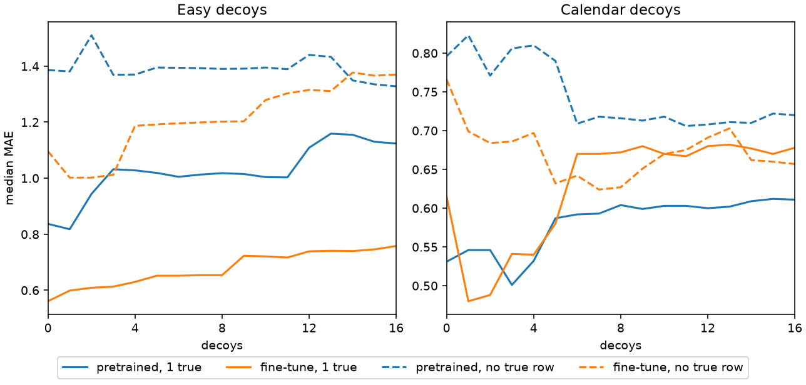

# A true covariate among decoys

Whether the model keeps a true covariate as unrelated rows, and rows that share only part of the target, are added beside it.

## Setup

Eight series per family, seed 0. Each series is drawn once: the target, one true covariate, and a pool of 16 decoys. A point on the x-axis keeps that target and that true covariate and takes the first N decoys from the pool. The dashed lines drop the true covariate and keep the same decoys. N is every integer from 0 through 16. The score is the median, over the eight series, of the mean absolute error of the median forecast on a 96-step horizon, from one raw forward pass.

Easy decoys are a random walk, a trend, or a season of periods 24 and 168. The target is the pooling signal, an AR(1) with persistence 0.98 and innovation scale 0.35, plus a sine of period 64 and amplitude 1.5. The true covariate is one noisy nonlinear view of that signal.

Calendar decoys are the exogenous rows as the generator stands now. Each one takes both cycles, the daily cycle with the weekly cycle flipped, or the slope, and adds a walk of its own. The true row is a noisy lagged reading of the driver plus the calendar. It is the only row that contains the driver.

The fine-tune is W&B run `j4qk2igb`, artifact `timestral-5m-pool-mix:v5`. It is 6000 steps at batch 16, with pooling at 15% of steps and the exogenous task at 40%. In that run a decoy shared both cycles and carried its own walk, there were one or two of them, and a quarter of the exogenous batches had no true reading. Unrelated series, one to eight of them, appeared only as a side of some pooling batches. The calendar panel is a harder set than that run saw: the partial matches, and stacks longer than two, were not in its training.

| decoys | pretrained, 1 true | fine-tune, 1 true | pretrained, none | fine-tune, none |
|---:|---:|---:|---:|---:|
| 0 | 0.837 | 0.561 | 1.386 | 1.096 |
| 1 | 0.818 | 0.599 | 1.381 | 1.002 |
| 2 | 0.944 | 0.609 | 1.510 | 1.002 |
| 6 | 1.005 | 0.652 | 1.394 | 1.196 |
| 8 | 1.018 | 0.654 | 1.390 | 1.202 |
| 16 | 1.124 | 0.758 | 1.328 | 1.370 |

Easy decoys. The figure has every count from 0 through 16.

| decoys | pretrained, 1 true | fine-tune, 1 true | pretrained, none | fine-tune, none |
|---:|---:|---:|---:|---:|
| 0 | 0.531 | 0.615 | 0.796 | 0.766 |
| 1 | 0.546 | 0.480 | 0.823 | 0.699 |
| 2 | 0.546 | 0.488 | 0.771 | 0.684 |
| 6 | 0.592 | 0.670 | 0.709 | 0.642 |
| 8 | 0.604 | 0.672 | 0.716 | 0.627 |
| 16 | 0.611 | 0.678 | 0.720 | 0.657 |

Calendar decoys.

## What it shows

On easy decoys the true row still wins, and the error still rises. With one true covariate the fine-tune goes from 0.561 at no decoys to 0.654 at eight and 0.758 at sixteen. The pretrained model goes from 0.837 to 1.018 to 1.124. At sixteen decoys the fine-tune with the true row is still well below the same model without it, 0.758 against 1.370. The unrelated rows add error. They do not replace the true row. The fine-tune is lower on every easy cell that has a true row. Without one, it is lower through thirteen decoys, and at fourteen, fifteen, and sixteen the pretrained model is slightly lower.

On calendar decoys the shared piece is used, and the fine-tune then stops using the true row. With no true row the pretrained model drops from about 0.80 to about 0.71 around six decoys and stays there. The fine-tune falls from 0.766 to 0.624 at seven decoys, about the error of a forecast that has the calendar and still has to guess the driver, and then drifts back toward 0.66. With the true row present, the pretrained model stays between 0.501 and 0.612, about a tenth below its no-true-row line the whole way. The fine-tune uses the true row at one and two decoys, 0.480 and 0.488, and from six decoys onward sits near 0.67, level with its own no-true-row line. Past that count the driver row is worth nothing to it.

## What follows

The fine-tune is better at a single true view, and better at pulling a shared cycle out of decoys. The pretrained model is better at keeping the driver row once several partial matches sit beside it. Pooling teaches the model that several similar rows are more evidence about the target. A calendar decoy is similar enough to get that treatment, and enough of them wash the driver out. An unrelated row is not, so it only adds noise.

Training never puts more than two decoys next to the true reading, which is the part of the curve where that reading still wins. The task that would punish the blend is a true driver row beside a longer stack of partial matches. It is listed under Research ideas. Eight series and one seed are enough for these shapes, not for the third decimal.
