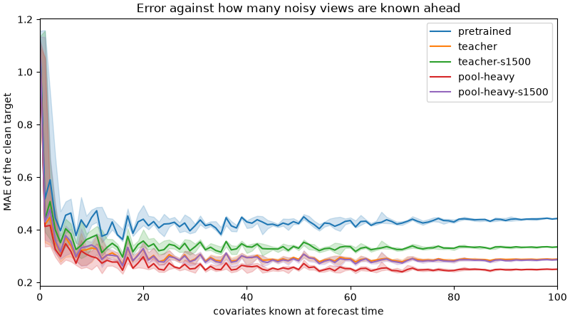

# More pooling on top of the teacher replay

Whether the [view curve](view-curve.md) can be pushed back down now that the [teacher replay](distill-replay.md) holds TIME. The replay mixture gave up part of the many-view gain: at 64 known views the error is 0.281, against 0.250 for the original pooling fine-tune.

## Setup

`configs/pool-heavy.yaml` is the teacher replay mixture with the pooling weight raised from 0.15 to 0.45, a share of 0.29 instead of 0.12. The view counts lean toward many views: weights 0.05, 0.08, 0.08, 0.10, 0.14, 0.20, 0.20, 0.15 over 0, 1, 2, 4, 8, 16, 32 and 64 views, where the replay mixture puts 8% on 32 and 64 together. Everything else is unchanged. Batch 16, peak lr 3e-5, seed 0, at 6000 and 1500 steps.

| run | steps | training run |
|---|---:|---|
| teacher replay | 6000 | [`uwkp74q8`](https://forge.coreweave.com/wandb/tfiedlerdev/time-series-models/runs/uwkp74q8) |
| teacher replay | 1500 | [`0eqgwi8b`](https://forge.coreweave.com/wandb/tfiedlerdev/time-series-models/runs/0eqgwi8b) |
| pool-heavy | 6000 | [`rp711tj5`](https://forge.coreweave.com/wandb/tfiedlerdev/time-series-models/runs/rp711tj5) |
| pool-heavy | 1500 | [`g69ty2xl`](https://forge.coreweave.com/wandb/tfiedlerdev/time-series-models/runs/g69ty2xl) and [`1onlhxnj`](https://forge.coreweave.com/wandb/tfiedlerdev/time-series-models/runs/1onlhxnj) |

The 1500-step run was started twice by mistake, with the same config and seed, so there are two artifact versions. On TIME they are at MASE +0.15% and +0.16%. That gap is GPU nondeterminism alone, and it is small next to the differences below. The view curve and TIME row below use `1onlhxnj`. Its fev run went to `g69ty2xl`.

## The view curve

`view_curve.py` now takes several checkpoints (`--checkpoint name=path`). Same signal, same 100 views and the same subsets as the original curve, scored on CPU.

| known views | pretrained | teacher | teacher, 1500 | pool-heavy | pool-heavy, 1500 |
|---:|---:|---:|---:|---:|---:|
| 0 | 1.156 | 1.099 | 1.134 | 1.123 | 1.134 |
| 1 | 0.517 | 0.419 | 0.439 | 0.412 | 0.430 |
| 8 | 0.437 | 0.322 | 0.340 | 0.320 | 0.332 |
| 16 | 0.363 | 0.268 | 0.296 | 0.246 | 0.263 |
| 32 | 0.416 | 0.280 | 0.324 | 0.247 | 0.276 |
| 64 | 0.417 | 0.281 | 0.324 | 0.243 | 0.275 |
| 100 | 0.443 | 0.289 | 0.335 | 0.250 | 0.286 |

## Benchmarks

Changes are in the error against pretrained Timestral-5M, so a negative number is a lower error. TIME is all 98 tasks: [`hsimmpwo`](https://forge.coreweave.com/wandb/tfiedlerdev/time-series-models/runs/hsimmpwo) and [`hcacmzy1`](https://forge.coreweave.com/wandb/tfiedlerdev/time-series-models/runs/hcacmzy1). fev is the 26-task covariate subset: [`yr1hrd6c`](https://forge.coreweave.com/wandb/tfiedlerdev/time-series-models/runs/yr1hrd6c) and [`frv6zpdx`](https://forge.coreweave.com/wandb/tfiedlerdev/time-series-models/runs/frv6zpdx).

| run | TIME MASE | TIME tasks >+1% | fev SQL | fev SQL median | fev tasks >+1% |
|---|---:|---:|---:|---:|---:|
| teacher, 6000 | +0.11% | 4 | +2.27% | +1.27% | 14 of 26 |
| teacher, 1500 | +0.06% | 4 | +0.83% | +0.13% | 7 |
| pool-heavy, 6000 | +0.22% | 10 | +2.49% | +1.73% | 15 |
| pool-heavy, 1500 | +0.16% | 6 | +1.19% | +0.41% | 11 |

A second seed of the 1500-step teacher run, W&B run [`eha1mkgj`](https://forge.coreweave.com/wandb/tfiedlerdev/time-series-models/runs/eha1mkgj), is at TIME MASE +0.21%, against +0.06% for seed 0. A TIME difference of a tenth of a point between two runs is within seed noise.

## What follows

Tripling the pooling share brings the many-view gain back. At 6000 steps the error at 64 views is 0.243, a little below the original pooling fine-tune's 0.250, and the cost over the replay mixture is about 0.1 points on TIME and 0.2 on fev. At 1500 steps the heavier share reaches 0.275, about what the replay mixture reached in 6000 steps. Its fev cost, +1.2%, is half that of the 6000-step replay run.

The short schedule is still the better trade for the benchmarks, and the pooling share is how to buy back what it gives up. The pooling weight of this run on top of the covariate replay, at 1500 steps, is the follow-up in `exp/combined`.
