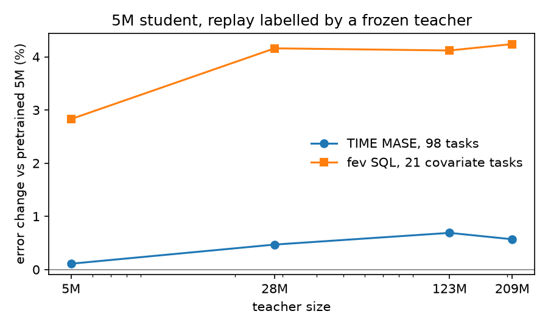

# A bigger teacher for the replay

Whether labelling the replay series with a bigger frozen Timestral, instead of the 5M model being fine-tuned, gives the student something to learn on top of holding its pretrained forecasts. The [teacher replay](distill-replay.md) uses the 5M model's own quantiles, which can only hold the student where it started.

## Setup

`distill.teacher` in the data config picks the frozen model that labels the distill task: 5M, 28M, 123M or 209M. All four sizes predict the same 21 quantiles, so the L1 loss on quantiles is unchanged. The student is always Timestral-5M, 6000 steps at batch 16, peak lr 3e-5, seed 0.

| run | mixture | training run |
|---|---|---|
| teacher 5M | `configs/distill-teacher.yaml`, distill share 0.2 | [`uwkp74q8`](https://forge.coreweave.com/wandb/tfiedlerdev/time-series-models/runs/uwkp74q8) |
| teacher 28M | the same, `teacher: 28M` | [`4a3hi6yx`](https://forge.coreweave.com/wandb/tfiedlerdev/time-series-models/runs/4a3hi6yx) |
| teacher 123M | the same, `teacher: 123M` | [`g84msfjh`](https://forge.coreweave.com/wandb/tfiedlerdev/time-series-models/runs/g84msfjh) |
| teacher 209M | the same, `teacher: 209M` | [`r2uppr46`](https://forge.coreweave.com/wandb/tfiedlerdev/time-series-models/runs/r2uppr46) |
| 209M, weight 0.5 | distill share 0.33 | [`5lpl095v`](https://forge.coreweave.com/wandb/tfiedlerdev/time-series-models/runs/5lpl095v) |
| 209M only | the distill task alone, no new tasks | [`40spaqux`](https://forge.coreweave.com/wandb/tfiedlerdev/time-series-models/runs/40spaqux) |

## Benchmarks

Changes are in the error against pretrained Timestral-5M, so a negative number is a lower error. TIME is all 98 tasks. fev is the 26-task covariate subset. The 123M fev run finished 21 of the 26 tasks, so the size curve in the figure uses the 21 tasks every run has.

| run | TIME MASE | TIME QL | TIME tasks >+1% | fev SQL, 26 tasks | fev SQL, 21 tasks | fev tasks worse |
|---|---:|---:|---:|---:|---:|---:|
| teacher 5M | +0.11% | +0.05% | 4 | +2.27% | +2.83% | 21 of 26 |
| teacher 28M | +0.47% | +0.21% | 22 | +3.31% | +4.16% | 20 of 26 |
| teacher 123M | +0.69% | +0.37% | 26 | | +4.12% | 18 of 21 |
| teacher 209M | +0.57% | +0.30% | 22 | +3.39% | +4.24% | 20 of 26 |
| 209M, weight 0.5 | +0.64% | +0.40% | 25 | +2.85% | | 20 of 26 |
| 209M only | +0.64% | +0.47% | 25 | +1.12% | | 12 of 26 |

The benchmark runs on W&B:

- TIME: 28M [`t4bo3303`](https://forge.coreweave.com/wandb/tfiedlerdev/time-series-models/runs/t4bo3303) (resumed from [`tqhzt79h`](https://forge.coreweave.com/wandb/tfiedlerdev/time-series-models/runs/tqhzt79h)), 123M [`l8ov5pvp`](https://forge.coreweave.com/wandb/tfiedlerdev/time-series-models/runs/l8ov5pvp), 209M [`e2meki9j`](https://forge.coreweave.com/wandb/tfiedlerdev/time-series-models/runs/e2meki9j), weight 0.5 [`27gf68xn`](https://forge.coreweave.com/wandb/tfiedlerdev/time-series-models/runs/27gf68xn), 209M only [`vqwznw4k`](https://forge.coreweave.com/wandb/tfiedlerdev/time-series-models/runs/vqwznw4k).
- fev: 28M [`9w94xvqq`](https://forge.coreweave.com/wandb/tfiedlerdev/time-series-models/runs/9w94xvqq), 123M [`3ssfpc03`](https://forge.coreweave.com/wandb/tfiedlerdev/time-series-models/runs/3ssfpc03), 209M [`ti8f5h26`](https://forge.coreweave.com/wandb/tfiedlerdev/time-series-models/runs/ti8f5h26), weight 0.5 [`ejeuqwao`](https://forge.coreweave.com/wandb/tfiedlerdev/time-series-models/runs/ejeuqwao), 209M only [`yx0s76jn`](https://forge.coreweave.com/wandb/tfiedlerdev/time-series-models/runs/yx0s76jn).

The teacher itself is much better on TIME than the student. Pretrained 209M finished 15 TIME tasks before it was stopped to free memory (it holds about 65 GB on the GB10). On those 15 tasks it is at MASE −7.23% against pretrained 5M, lower on all 15. The 5M students on the same 15 tasks: 5M teacher +0.33%, 28M +0.98%, 123M +1.10%, 209M +0.88%, 209M only +0.42%.

## The training eval

32 series, the same draws for every model, from the `exp/combined` code. W&B runs [`oh8ud8g3`](https://forge.coreweave.com/wandb/tfiedlerdev/time-series-models/runs/oh8ud8g3) (pretrained, ref-main, the four teacher sizes), [`e7kivcbo`](https://forge.coreweave.com/wandb/tfiedlerdev/time-series-models/runs/e7kivcbo) (weight 0.5) and [`n1zoxan2`](https://forge.coreweave.com/wandb/tfiedlerdev/time-series-models/runs/n1zoxan2) (209M only). The pretrained column is the same in all three.

| task | pretrained | 5M | 28M | 123M | 209M | 209M w0.5 | 209M only |
|---|---:|---:|---:|---:|---:|---:|---:|
| generic/kernel | 0.219 | 0.223 | 0.221 | 0.176 | 0.154 | 0.168 | 0.166 |
| generic/composite | 0.234 | 0.233 | 0.215 | 0.217 | 0.211 | 0.215 | 0.221 |
| generic/intermittent | 0.561 | 0.563 | 0.555 | 0.527 | 0.536 | 0.536 | 0.529 |
| generic/events | 0.326 | 0.325 | 0.305 | 0.307 | 0.307 | 0.296 | 0.289 |
| real/heldout | 0.502 | 0.507 | 0.507 | 0.497 | 0.490 | 0.478 | 0.496 |
| pool/64 | 0.380 | 0.266 | 0.260 | 0.261 | 0.262 | 0.263 | 0.407 |
| views/64 | 0.351 | 0.264 | 0.257 | 0.258 | 0.257 | 0.261 | 0.364 |
| long/walk | 1.670 | 1.745 | 1.733 | 1.731 | 1.718 | 1.732 | 1.698 |

## What follows

The student learns what the bigger teacher shows it, and that does not reach the benchmarks. On synthetic series the 209M labels move the 5M student well below its own pretrained error, 0.219 to 0.154 on kernel draws. The held-out real series from the GIFT-Eval pretraining corpus also improve slightly, 0.502 to 0.490. Yet TIME MASE rises by about 0.5%, and 22 of the 98 tasks get more than 1% worse, against 4 with the 5M teacher. The teacher itself is 7% better than the student on TIME, so the gap is not in the labels. It is in what a 5M model can take from them.

The run with nothing but the 209M replay settles where the TIME cost comes from. It learns no pooling and trains on no new task, and still lands at +0.64% on TIME. Imitating a bigger model on synthetic series is enough by itself to pull the student off its pretrained solution on real data. On fev it is the least costly run, +1.1%, because it skips the covariate-shaped synthetic tasks, which carry the fev cost.

The size makes little difference beyond the first step: 28M, 123M and 209M are within a few tenths of a percent on both benchmarks. A heavier 209M weight does not change TIME either.

For holding the benchmarks the replay should keep the student's own pretrained labels. A bigger teacher could still help where its labels come from real series the student will see again, but that needs a leak-free real corpus and is a separate experiment. Distilling a bigger Timestral into a smaller one more generally is its own project, with the student's capacity as the limit.
