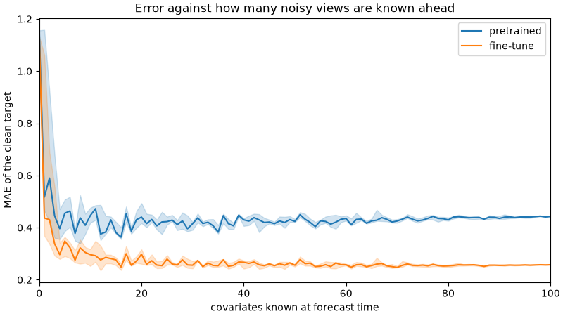

# Noisy views of one signal

The first thing this fine-tune was asked to learn: given several noisy, nonlinear views of a clean series, and told which of them continue past the forecast origin, recover that series.

## Setup

One signal, an AR(1) with persistence 0.98 and innovation scale 0.35, plus a sine of period 64 and amplitude 1.5. One hundred views of it. Each view is a random power, a tanh, or a rational curve of the signal, about half of them delayed by 1 to 40 steps, then Gaussian noise at 10–70% of that view's own spread.

A point on the x-axis is how many of those views are known over the 96-step horizon. The rest stop at the origin and are passed as past covariates. The ends of the curve, zero views and all one hundred, are a single draw. Every other count is the median of eight random subsets, with the band the interquartile range. `clip_nonnegative` is off, and the forecast uses symmetric averaging.

The blue curve is pretrained Timestral-5M. The orange curve is the 6000-step batch-16 fine-tune, W&B run `16bbz8p0`, which spent 30% of its steps on this pooling task. The figure is from that checkpoint.

| known views | pretrained | fine-tune |
|---:|---:|---:|
| 0 | 1.156 | 1.133 |
| 1 | 0.517 | 0.436 |
| 8 | 0.437 | 0.322 |
| 16 | 0.363 | 0.249 |
| 32 | 0.416 | 0.250 |
| 64 | 0.417 | 0.250 |
| 100 | 0.443 | 0.258 |

## What it shows

With nothing known over the horizon the two models are close, around 1.15. The pretrained model drops to about 0.43 by ten views and stays there through one hundred. The fine-tune reaches about 0.25 by sixteen views and holds that through one hundred. Pooling is learned, and it generalizes past the largest count used in training, which was 64.

The curve is flat after about sixteen views, so extra views do not buy a lower error. Later mixes put most of the pooling draws on 1 to 16 and keep 32 and 64 only as a thin tail, so that flat region stays in the training support.

## Why the error does not go to zero

If each view were the signal plus its own independent noise, averaging them would send the error down like one over square root of the count. On this same signal, with noise at 40% of the signal's spread, that average has horizon MAE 0.59 at one view, 0.15 at sixteen, and 0.08 at sixty-four.

These views are not that. Each one is a different function of the signal, often shifted, and then noised. A shifted view does not contain the end of the horizon. The rational curve takes the same value at two signal levels. Inverting the tanh amplifies noise where the tanh is flat.

An oracle that is told the shift and the function, drops the shifted and the non-invertible rows, inverts the rest, and averages them, still has a median horizon MAE of about 0.18. Of sixty-four views, about twenty survive that filter. The best single inverted view is about 0.21. The fine-tune's 0.25 sits just above that floor. The signal's own spread is about 2, so 0.25 is a small fraction of it. A pooling-only fine-tune could close some of the distance from 0.25 toward 0.18. With this generator it has no path to zero.
